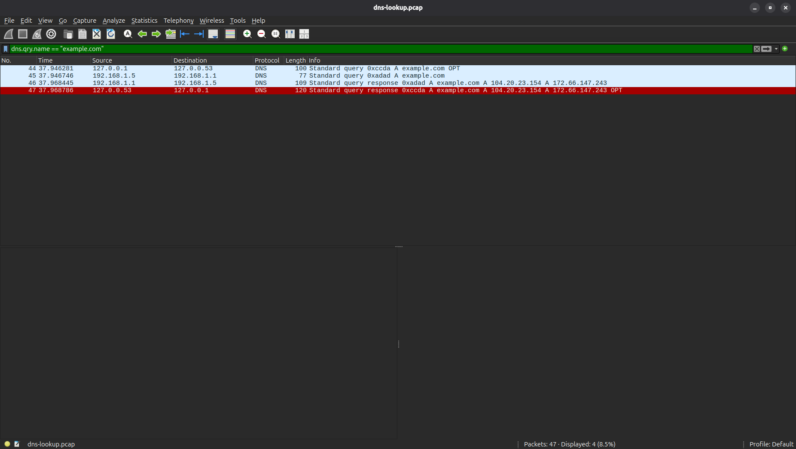

# DNS Lookup for `example.com`

## 1. Objective
To capture and analyze a standard DNS query and response to see how a domain name is resolved into an IP address at the packet level.

## 2. Environment
*   **Command:** `dig example.com`
*   **Capture Tool:** `sudo tcpdump -i any -nn -s 0 -w captures/dns-lookup.pcap 'port 53'`
*   **Filter applied in Wireshark:** `dns.qry.name == "example.com"`

## 3. Packet Sequence
The capture contained 47 packets of background OS and browser traffic. The relevant sequence for our `dig` request is:
*   **Frame 44:** The `dig` program (`127.0.0.1`) asks the local resolver (`127.0.0.53`) for the IP address.
*   **Frame 45:** The local resolver asks the router (`192.168.1.1`) for the IP address over the LAN (`192.168.1.5`).
*   **Frame 46:** The router replies to the local resolver.
*   **Frame 47:** The local resolver replies to the `dig` program.

## 4. Protocol Details
*   **Transport:** UDP on Port 53.
*   **Query:** The client requested an `A` record (IPv4) for `example.com`.
*   **Response:** The resolver returned the IP addresses `104.20.23.154` and `172.66.147.243`.

## 5. Interpretation
This capture demonstrates a two-leg DNS journey. `dig` first talks to the internal local resolver (`systemd-resolved`) over the loopback interface (`127.0.0.1` to `127.0.0.53`). Because the answer was not cached, the resolver routed the query out the laptop's physical Wi-Fi interface (`192.168.1.5`) to the LAN router (`192.168.1.1`). The response followed the exact same path in reverse. 

## 6. Security Considerations
Capturing and analyzing raw traffic is foundational for incident response and threat hunting. Standard DNS uses cleartext UDP, which means anyone on the local network (or the ISP) can read the queries. This makes DNS a prime target for passive sniffing and data exfiltration (DNS Tunneling). Understanding the baseline structure of a legitimate query is required to detect anomalies, and modern environments should use DNS-over-HTTPS (DoH) or DNS-over-TLS (DoT) to encrypt these requests.

## 7. Visual Evidence
*   
