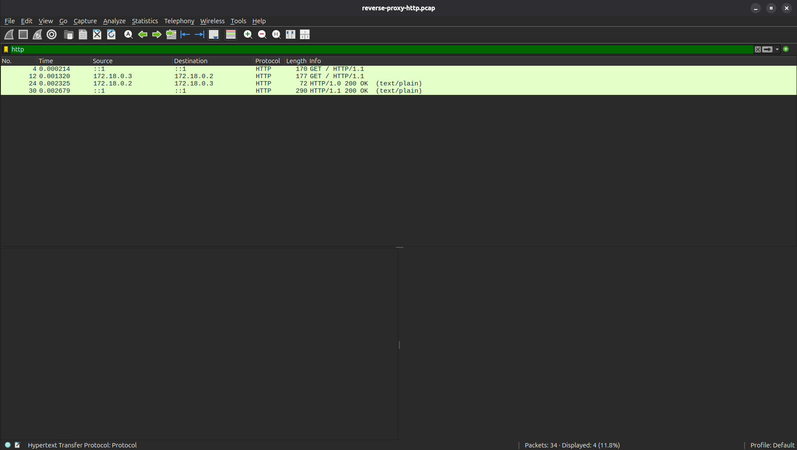
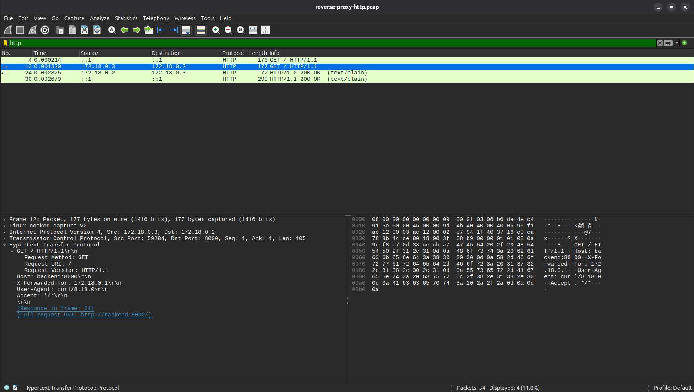

# HTTP Reverse Proxy via Docker

## 1. Objective
To capture and analyze an HTTP request passing through a reverse proxy (Nginx) to a backend server (Python) inside a Docker environment, demonstrating network isolation, NAT routing, and header injection.

## 2. Environment
*   **Command:** `curl -v http://localhost:8080`
*   **Capture Tool:** `sudo tcpdump -i any -nn -s 0 -w captures/reverse-proxy-http.pcap 'tcp port 8080 or tcp port 8000'`
    *   *Note:* The `-i any` flag instructs `tcpdump` to capture packets across ALL network interfaces, including the host loopback and the virtual Docker bridge.
*   **Filter applied in Wireshark:** `http`
*   **Infrastructure Code:** Defined in the [`/proxy-lab`](../proxy-lab) folder of this repository.

## 3. Packet Sequence
The capture demonstrates two distinct TCP connections, translating between the host machine and the Docker internal network:
*   **Frame 4 (Host Request):** `curl` sends a `GET / HTTP/1.1` request via the IPv6 loopback interface (`::1`) to Docker on port **8080**.
*   **Frame 12 (Internal Request):** The proxy (Nginx at `172.18.0.3`) terminates the client connection and initiates a new `GET / HTTP/1.1` request to the backend (Python at `172.18.0.2`) on port **8000**. Nginx injects the `X-Forwarded-For: 172.18.0.1` header.
*   **Frame 24 (Internal Reply):** The backend replies to Nginx. It was noted that Python defaults to `HTTP/1.0`, which closes the connection after sending the response.
*   **Frame 30 (Host Reply):** Nginx replies to the client (`::1`). Nginx upgrades the response header to `HTTP/1.1` (keep-alive) before sending it to `curl`.

## 4. Protocol Details
*   **Client to Proxy:** TCP Port 8080 (Mapped via `docker-compose.yml` to Container Port 80).
*   **Proxy to Backend:** TCP Port 8000 (Internal Docker Network only).
*   **Client IP:** `::1` (IPv6 loopback).
*   **Proxy IP:** `172.18.0.3` (Docker bridge network).
*   **Backend IP:** `172.18.0.2` (Docker bridge network).
*   **Injected Header:** `X-Forwarded-For: 172.18.0.1`.

## 5. Interpretation
Docker's NAT rules intercept the packet sent to host port `8080` and redirect it to the Nginx container on port `80`. Because the client and proxy are on different network namespaces, Docker rewrites the source IP to its gateway (`172.18.0.1`). 

Nginx acts as a reverse proxy: it closes the initial connection and opens a second connection to the Python backend. To ensure the backend knows who the original client was, Nginx adds the `X-Forwarded-For` header.

## 6. Security Considerations
*   **Backend Isolation:** The backend has no published ports in the `docker-compose.yml`. It is entirely shielded from the host machine and can only be reached through the proxy.
*   **Header Spoofing:** The `X-Forwarded-For` header is only trustworthy if the backend is strictly firewalled to accept traffic *only* from the proxy. Otherwise, an attacker can spoof this header to bypass IP-based access controls.
*   **Protocol Mismatch & HTTP Request Smuggling:** Python defaults to `HTTP/1.0` while Nginx enforces `HTTP/1.1`. If a proxy translates between mismatched HTTP versions without strict header sanitation, it becomes vulnerable to HTTP Request Smuggling (CL.TE or TE.CL). An attacker can exploit differing `Content-Length` and `Transfer-Encoding` interpretations to smuggle a hidden request through the proxy to the backend, poisoning the connection for the next user. 
    *   *Hardening:* Proxies must be configured to reject requests containing both `Content-Length` and `Transfer-Encoding` headers, and enforce a single, consistent protocol version across the boundary.

## 7. Visual Evidence
*   
*   
